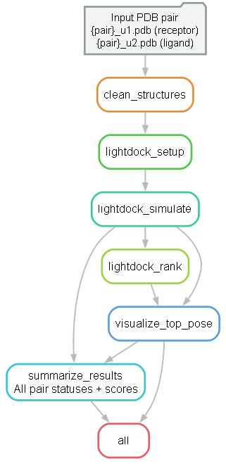

# Protein-protein docking with Snakemake

Automate preprocessing, flexible LightDock docking, pose ranking and PyMOL
visualization for one or more protein pairs. Matching local PDB files are discovered
automatically. Successful pairs produce a top-ranked complex and figure. Every discovered pair,
including unsuccessful pairs, contributes a status row to one summary table.
Pair-specific failures are recorded while independent pairs continue.

## Requirements and software

Run on Linux. The documented Windows setup uses Ubuntu through WSL2. Install
WSL/Ubuntu and a Conda distribution such as Miniforge first. VS Code and Microsoft's
WSL extension are optional editing tools, not execution requirements.

Two separate environments keep the workflow manager and scientific tools isolated:

| Definition | Contents | Setup |
|---|---|---|
| `environment.yaml` | Python 3.14.10, Snakemake 9.27.1, Graphviz 14.1.2, pandas >=2.2 | Create manually once before running Snakemake |
| `envs/workflow_tools.yaml` | Python 3.10, LightDock 1.0.0rc2, PDBFixer 1.10, PyMOL 3.1.0 and scientific dependencies | Snakemake creates it with `--sdm conda` |

**Created automatically on first use; reused afterwards:** the tool environment is
stored under `.snakemake/conda/`. It is shared by rules referencing the same YAML.
It is not reinstalled for every pair or run. Changing the YAML or removing the
environment can trigger creation of a new one.

### Recorded execution platform

The following versions describe the recorded reference platform. They are
observations, rather than strict OS or Conda requirements. Software installed
through Conda is specified separately in the environment YAML files.

| Component | Version |
|---|---|
| Ubuntu | 26.04.1 LTS |
| Conda | 26.9.4 |
| Snakemake | 9.27.1 |
| Python for Snakemake | 3.14.10 |
| WSL | 2.7.14.0 |
| Linux kernel | 6.18.33.2-2 |
| WSLg | 1.0.73.2 |
| Windows build | 10.0.26200.9974 |

The YAML files specify requested tool versions. For a record of exact resolved
packages, export the installed environments after creation (see Reproducibility).

## Installation

Clone or download this repository. Open an Ubuntu terminal in its root folder,
where `Snakefile` and `environment.yaml` are located. No particular parent folder
or personal directory is required.

```bash
# One-time setup of the workflow manager environment.
conda env create -f environment.yaml

# Activate whenever starting a new terminal.
conda activate snakemake-protein-docking
snakemake --version
```

An existing compatible Snakemake environment may also be used. The environment name
above comes from `environment.yaml`; it does not have to be named `snakemake`.

## Prepare the inputs

Place each receptor/ligand pair directly in the input folder, using this convention:

```text
data/input/
  pair_1_u1.pdb      # receptor
  pair_1_u2.pdb      # ligand (second protein)
  pair_2_u1.pdb
  pair_2_u2.pdb
```

The prefix is the pair ID. IDs can contain letters, digits, underscores and hyphens,
without spaces. Use exactly the same prefix for both partners and lowercase `.pdb`.
The folder is scanned at workflow startup. An ID found with either suffix is selected.
The preparation step checks both partners for missing files, empty files and protein
ATOM records. An incomplete or invalid pair is reported as failed; other pairs can
continue. This checks filenames and basic contents, not biological compatibility.
Nested subfolders are not scanned. Other filenames are not treated as pairs.
An empty folder or an unsafe pair ID stops planning with an explanatory error.

To use a subset, put only those pairs in another input folder and change `input_dir`
in the config. Each docking run combines two partners. Adding more pairs does not
create a single docking calculation with three or more partners.

### Included demonstration inputs

The repository includes two teaching pairs in **`data/example/`** under generic
names. **`data/input/` starts empty** and is reserved for your own inputs. The
example folder is a sibling of `input/`, not a subfolder of it.

| ID | Receptor source | Ligand source |
|---|---|---|
| `pair_1` | [RCSB 1EZA](https://www.rcsb.org/structure/1EZA) | [RCSB 1HDN](https://www.rcsb.org/structure/1HDN) |
| `pair_2` | [RCSB 1TPO](https://www.rcsb.org/structure/1TPO) | [RCSB 4PTI](https://www.rcsb.org/structure/4PTI) |

These are runnable example inputs, not a claim that the workflow accepts only these
proteins or that these files are the Dockground X-ray dataset. Your own dataset and the examples remain separate; select one folder at a time.
You do not need to delete the examples.

For Dockground X-ray Unbound Set 1, copy matching `<id>_u1.pdb` / `<id>_u2.pdb` files
into the selected folder; do not combine unrelated prefixes or use bound `_b` files
when the task requires unbound inputs. Alternatively obtain appropriate interacting
partners from RCSB and rename them to this convention. Check chains and biological
assemblies yourself: the workflow does not automatically select the desired chain.

## Configuration

Edit `config/config.yaml`:

```yaml
input_dir: "data/input"
docking_params:
  swarms: 10
  glowworms: 20
  steps: 20
```

`input_dir` selects the folder; relative paths resolve from the project root and
absolute paths also work. The default is `data/input`; set it to `data/example`
to run the examples. Do not use generated `work/` or `results/` as input folders.
`swarms` controls search groups, `glowworms` the candidate poses in each group, and
`steps` the optimization iterations. Settings must be positive integers and apply
to every pair. The supplied low values are for a short demonstration.

For explanations of swarms, glowworms, optimization steps and further setup
parameters, see the official [LightDock basics documentation](https://lightdock.org/tutorials/basics).

## Run

From the project root, with the manager environment activated:

```bash
# First test: select the supplied examples without changing config.yaml.
snakemake --cores 4 --sdm conda --config input_dir=data/example --dry-run
snakemake --cores 4 --sdm conda --config input_dir=data/example --printshellcmds

# Your own pairs: place files in data/input, then preview the plan.
snakemake --cores 4 --sdm conda --dry-run

# Create/reuse tool environments and execute required jobs.
snakemake --cores 4 --sdm conda --printshellcmds
```

The first run needs internet access for package installation. Later runs reuse
complete outputs when inputs, settings and tracked code have not changed. After an
interrupted run, use the same command with `--rerun-incomplete` if requested.

## Workflow and folder layout

```text
Snakefile                    # Rules, discovery, final targets and dependencies
config/config.yaml           # Input folder and shared docking settings
environment.yaml             # Snakemake manager environment
envs/workflow_tools.yaml     # Preparation, docking and plotting tools
scripts/                     # Python helpers called by the rules
data/input/                  # Your original PDB partners (empty initially)
data/example/                # Supplied example pairs (select explicitly)
work/<pair>/                 # Cleaned PDBs, setup, modes, swarms and rankings
results/<pair>/              # Status; model/metadata/figure when available
results/summary_metrics.csv  # Combined table for all selected pairs
logs/<pair>/                 # Per-step software messages and errors
logs/summary_metrics.log     # Shared summary script log
benchmarks/<pair>/           # Simulation and ranking runtime/memory records
docs/                        # Generic workflow diagrams
```

1. **Discover pairs:** identify IDs from local `_u1` / `_u2` files and define
   final report targets. Each pair is processed independently.
2. **Prepare:** PDBFixer removes waters/heterogens, models detected missing residues,
   repairs missing heavy atoms and adds hydrogens at pH 7.0.
3. **Set up:** `lgd_setup.py` creates starting poses, processed PDBs and ANM modes;
   hydrogens, water and OXT atoms are excluded from LightDock scoring inputs.
4. **Simulate:** `lgd_run.py` optimizes poses using dfire2 and ANM flexibility.
5. **Rank/export:** `lgd_rank.py` ranks candidates; `export_top_pose.py` selects the
   exact winning swarm/glowworm and calls `lgd_generate_conformations.py` to
   reconstruct that pose with ANM deformation.
6. **Visualize:** `plot_top_pose.py` uses PyMOL to render complete receptor (blue)
   and ligand (orange), including multichain partners.
7. **Summarize:** `summarize_metrics.py` combines rankings and simulation benchmarks
   and status reports into one CSV, with one row per detected pair, including failures.

### Workflow diagrams




Generic examples start with the input PDB partners and show the dependencies for
one and two pairs. Gray input boxes represent files, not extra Snakemake rules.
The colored boxes represent workflow jobs. Local discovery occurs before jobs are
scheduled. The diagrams stay applicable when protein identities change. They are
documentation assets and are not regenerated on every run.
To inspect a current input-specific DAG optionally run:

```bash
snakemake --dag | dot -Tpng > current_dag.png
```

## Results

For every ID, `results/<pair>/status.json` records the outcome. Successful pairs
also contain:

| File | Meaning |
|---|---|
| `<pair>_top_1.pdb` | Highest-ranked reconstructed docked complex |
| `<pair>_top_1.json` | Selected swarm/glowworm IDs, step count and ANM provenance |
| `<pair>_top_pose.png` | PyMOL rendering, 1600 x 1200 pixels |

Failed docking pairs have a status report without a fabricated PDB or image.
If only visualization fails, the valid docked PDB and selection metadata remain.

`results/summary_metrics.csv` has one row for **every** discovered pair:

| Columns | Meaning |
|---|---|
| `pair`, `status` | ID and overall `success` or `failed` |
| `failed_stage`, `error`, `log_path` | Original failing step, error and its log |
| `top_swarm_id`, `top_glowworm_id`, `top_dfire2_score` | Best pose, if ranking/export succeeded |
| `simulate_wall_time_s`, `simulate_max_rss_mb` | Simulation job runtime and memory, if simulation succeeded |
| `docked_structure`, `figure` | Available final artifact paths |

Unavailable values are blank. Simulation benchmarks include runner overhead and
copying the setup files, but not other stages or environment installation. Failed
or skipped simulation measurements are omitted from the CSV. Raw benchmark files
still exist for skipped jobs; their tiny durations are not docking timings.

Intermediates remain in `work/` for inspection and reuse. They are not final
submission deliverables. Results, work files, logs, benchmarks and environments
are excluded by `.gitignore`; they remain locally after execution. Removing `work/`
will discard reusable intermediate calculations.

## Logs, benchmarks and troubleshooting

`log:` names the file. The stage runner captures software output and error
tracebacks into it; the summary helper writes its own log.
For example:

```bash
tail -n 30 logs/pair_1/lightdock_simulate.log
cat benchmarks/pair_1/simulate.txt
```

Benchmark files are tab-separated tables produced by Snakemake, with runtime (`s`)
and memory (`max_rss`, in MB), plus other available measurements. Logs contain
software progress, warnings and error details. A humorous Kraken message in a
LightDock log is normal progress, not itself a failure.

| Symptom | Action |
|---|---|
| No pairs found | Check `input_dir`, file suffixes and current working directory |
| Missing/empty partner | The pair is marked failed; add the partner and rerun |
| Environment creation fails | Inspect Conda/pip output, internet access and YAML versions |
| A pair fails during docking | Check the CSV's `failed_stage` and `log_path` |
| Rendering fails | Inspect `logs/<pair>/visualize.log` and check the reconstructed structure |

### Failure handling and retries

Each pair stage writes a `status.json` inside its own output directory. A
pair-specific error is logged and recorded as `failed`. Downstream steps for that
pair write `skipped` reports that retain the original error and log path. Independent
pairs continue, and the final summary includes successes and failures. A rendering
failure does not discard a successfully docked structure.

**A completed Snakemake batch does not mean every protein pair succeeded.** The
terminal prints successful/failed pair counts. Always inspect the CSV's `status`
column and `logs/summary_metrics.log`. `--keep-going` alone would not produce this
failure-aware summary, so the workflow uses the explicit stage runner instead.

Invalid global settings, no selected inputs, environment creation failures,
unreadable/corrupt status reports, inability to write reports and interruptions
remain workflow errors. This is not a recovery mechanism for a crashed computer.

Failed reports are saved results too: an unchanged failed pair is not retried on
every invocation. Fix the input or underlying problem, then rerun. Changes to input
files are tracked automatically. To explicitly retry just one pair from preparation
onwards, force its preparation output (replace `pair_1` with the failed ID):

```bash
snakemake --cores 4 --sdm conda --forcerun work/pair_1/cleaned
```

Use the same `input_dir` selection as the original run; for example add
`--config input_dir=data/example` **before** `--forcerun`. The selected pair's
downstream stages and combined summary are rebuilt, while unchanged successful
pairs are reused. Preserve earlier logs before retrying; per-stage logs are
overwritten. `--rerun-incomplete` handles interrupted Snakemake jobs, whereas
`--forcerun` explicitly retries a recorded pair failure.

Each stage declares a `directory()` output because its scientific artifacts are
optional on failure. Snakemake tracks the directory's timestamp. Do not edit or
delete individual generated files inside these directories: rerun the owning
stage if its contents need rebuilding. Only the runner's precisely owned stage
directory is cleared on a rerun. Original input files are never cleaned up.

## Reproducibility and interpretation

Use Git to retain code/configuration, preserve original PDB provenance, and archive
outputs and logs separately when needed. Record exactly resolved packages with:

```bash
conda env export -n snakemake-protein-docking > manager_environment_resolved.yaml
# List the environments managed by Snakemake, then export the relevant prefix.
snakemake --list-conda-envs
conda env export --prefix .snakemake/conda/REPLACE_WITH_LISTED_ENV > tools_environment_resolved.yaml
```

Exported environment files may include machine-specific prefix lines. They record
the installation; they do not replace the portable environment definitions.

Low sampling values demonstrate automation, not scientific validation. A top-ranked
pose is a prediction, not proof of binding. dfire2 scores are scoring-function
values rather than measured binding energies. Missing-residue reconstruction is
modeling, and important cofactors may be removed by heterogen cleanup. Inspect
inputs and prepared structures and validate predictions against suitable references.

## References

- [Snakemake documentation](https://snakemake.readthedocs.io/)
- [LightDock documentation and tutorials](https://lightdock.org/)
- [PDBFixer](https://github.com/openmm/pdbfixer)
- [PyMOL](https://pymol.org/)
- [RCSB PDB](https://www.rcsb.org/)
