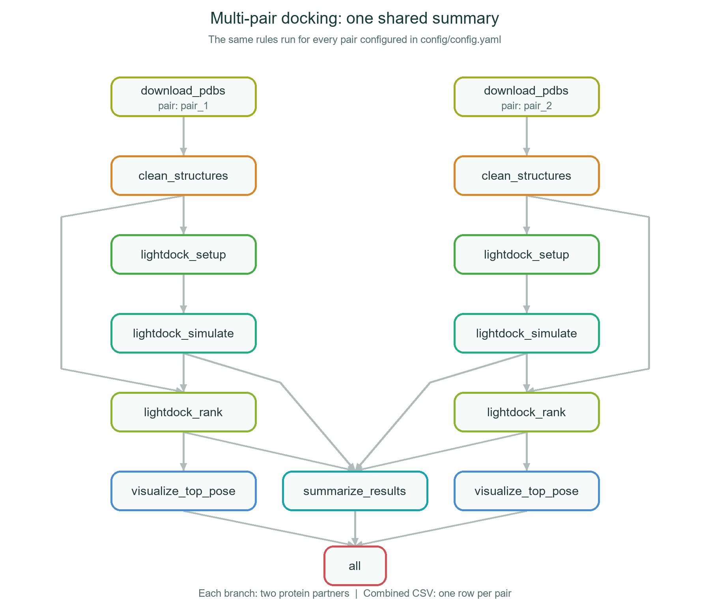

# Multi-pair protein-protein docking with Snakemake

This workflow downloads, preprocesses, docks, ranks and visualizes one or more
protein pairs. The same wildcard rules are reused for every entry in the config.
Each docking job has two partners; adding pairs creates additional independent jobs,
not a single docking calculation with three or more partners.

## Folder structure

```text
Snakemake_Project04/
  Snakefile
  config/config.yaml           # Pair IDs, direct PDB URLs and docking settings
  environment.yaml             # Environment for running Snakemake
  envs/lightdock_env.yaml       # Tools used by the workflow rules
  scripts/
    fix_and_clean_pdb.py        # PDBFixer preparation (original script)
    export_top_pose.py          # Exact winning pose and ANM reconstruction
    plot_top_pose.py            # PyMOL rendering of both complete partners
    summarize_metrics.py       # One combined results table (original script)
  data/                        # Downloaded input PDBs
  results/<pair>/              # Prepared structures, docking files, top pose, figure
  results/summary_metrics.csv  # One row per configured pair
  logs/<pair>/                 # Command output and errors
  benchmarks/<pair>/           # Runtime and memory measurements
  dag_multipair.png            # Two example pair branches and shared summary
  rulegraph.png                # High-level rule graph (no individual pair labels)
```

## Software setup

For this Windows setup, Ubuntu/WSL, Conda and Snakemake must already be available.
The Snakemake environment runs the workflow manager. The workflow's separate tool
environment contains Python 3.10, LightDock, PDBFixer, PyMOL and scientific dependencies,
as specified in `envs/lightdock_env.yaml`. The environment files remain unchanged
from the colleague's version.

**Created automatically on first use; reused afterwards:** with `--sdm conda`,
Snakemake creates missing tool environments and stores them under `.snakemake/conda/`.
Subsequent runs reuse them. A changed environment definition or a deleted environment
can require a new environment. It is not installed separately for every pair.

## Configure the proteins

Edit `config/config.yaml`. The generic IDs `pair_1` and `pair_2` are labels, not
fixed protein identities. The supplied real PDB URLs keep the example runnable.
Replace both URLs with direct PDB-file URLs for your chosen pair. Local filesystem
paths are not accepted by the current download rule. Check that each downloaded
PDB contains the intended protein chains; this workflow does not select chains.

Add `pair_3`, `pair_4`, etc. using the same receptor_url / ligand_url structure.
Use unique IDs with letters, digits and underscores, without spaces. The commented
config explains each setting. Parameters are shared across all configured pairs.

Use a NEW pair ID when changing the input structures after a run. Otherwise old
`data/<pair>_rec.pdb` and `data/<pair>_lig.pdb` files may be reused. Old result folders
can remain locally, but only currently configured IDs enter the combined summary.

## Run in Ubuntu (including a VS Code WSL terminal)

```bash
cd ~/exercise4/Snakemake_Project04
conda activate snakemake
snakemake --cores 4 --sdm conda --dry-run
# Optional: create missing tool environments without executing the analysis.
snakemake --cores 4 --sdm conda --conda-create-envs-only
snakemake --cores 4 --sdm conda --printshellcmds
```

Use `--cores 1` instead if desired. Snakemake limits rule threads accordingly.
The generic IDs create new data/result paths, so the first run downloads their PDBs.
Previously downloaded files named with the old biological pair IDs are not used.

## Workflow steps

1. `download_pdbs`: download the receptor and ligand URLs for each pair.
2. `clean_structures`: run PDBFixer to remove waters/heterogens, model detected missing
   residues, repair missing heavy atoms and add hydrogens at pH 7.0. Inspect repaired
   structures when interpreting results; modeled regions are predictions.
3. `lightdock_setup`: create swarms, processed structures, masks and ANM normal modes.
   Water, hydrogen and OXT atoms are excluded from the LightDock inputs.
4. `lightdock_simulate`: optimize candidate poses with dfire2 scoring and ANM flexibility.
5. `lightdock_rank`: rank poses globally, select the exact winning swarm AND glowworm,
   and reconstruct its ANM-deformed structure. Save selection metadata as JSON.
6. `visualize_top_pose`: render the complete receptor in blue and ligand in orange.
   Processed atom counts identify partners, including multichain proteins.
7. `summarize_results`: combine rankings and simulation benchmarks from ALL configured
   pairs into one CSV. `rule all` requests the figures and combined summary; it does
   not itself merge file contents.

## Outputs

For each configured ID (for example, `pair_1`):

- `results/pair_1/pair_1_top_1.pdb`: highest-ranked reconstructed complex.
- `results/pair_1/pair_1_top_1.json`: selected swarm/glowworm metadata.
- `results/pair_1/visualization/pair_1_top_pose.png`: rendered docking figure.
- `results/summary_metrics.csv`: pair ID, winning IDs, dfire2 score, simulation time
  and maximum resident memory, with one row per configured pair.

The small demonstration settings test automation. A top score alone does not validate
an interaction, and dfire2 scores should not be described as measured binding energies.

## Multipair graph



The supplied diagram shows the rule dependencies for the two example IDs, including
both branches feeding one `summarize_results` job. It is an illustrative job graph;
expanding multiple swarm files is represented by one simulation node per pair.
To generate Snakemake's current DAG yourself (requires Graphviz `dot`):

```bash
snakemake --dag | dot -Tpng > dag_multipair.png
```

Its appearance can differ, and already-existing outputs affect the jobs shown.

## Changes relative to the original colleague version

- Keep the original rule names, folder conventions, software definitions and settings.
- Add numbered explanatory comments to the Snakefile.
- Correct winning glowworm selection, stage ANM files for reconstruction, and color
  complete receptor/ligand partners while preserving bonds in the figure.
- Use generic config pair IDs, explain inputs/parameters, and update the multipair graph.
- Replace archived example result tables with descriptions of newly generated outputs.

## Applying the update-only ZIP

Copy its contents into the existing repository root, replacing matching files.
Keep `.git`, your current `.gitignore`, the original environment definitions and the
unchanged preparation/summary scripts. The ZIP contains only six new or changed files.
No environments, downloaded data, results or Git metadata are included.
