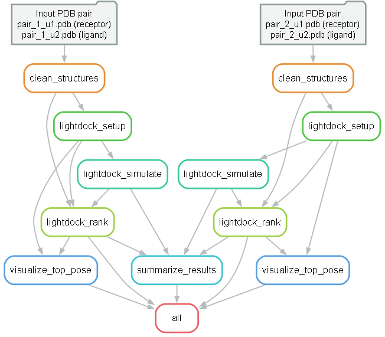

# Protein-protein docking with Snakemake

Automate preprocessing, flexible LightDock docking, pose ranking and PyMOL
visualization for one or more protein pairs. Matching local PDB files are discovered
automatically. Each pair produces a top-ranked complex and figure, and all pairs
contribute to one summary table.

## Requirements and software

Run on Linux. The documented Windows setup uses Ubuntu through WSL2. Install
WSL/Ubuntu and a Conda distribution such as Miniforge first. VS Code and Microsoft's
WSL extension are optional editing tools, not execution requirements.

Two separate environments keep the workflow manager and scientific tools isolated:

| Definition | Contents | Setup |
|---|---|---|
| `environment.yaml` | Python 3.14.10, Snakemake 9.27.1, Graphviz 14.1.2, pandas >=2.2 | Create manually once before running Snakemake |
| `envs/workflow_tools.yaml` | Python 3.10, LightDock 1.0.0rc2, PDBFixer 1.10, PyMOL 3.1.0 and scientific dependencies | Snakemake creates it with `--sdm conda` |

**Created automatically on first use; reused afterwards:** the tool environment is
stored under `.snakemake/conda/`. It is shared by rules referencing the same YAML.
It is not reinstalled for every pair or run. Changing the YAML or removing the
environment can trigger creation of a new one.

### Recorded execution platform

The following versions describe the recorded reference platform. They are
observations, rather than strict OS or Conda requirements. Software installed
through Conda is specified separately in the environment YAML files.

| Component | Version |
|---|---|
| Ubuntu | 26.04.1 LTS |
| Conda | 26.9.4 |
| Snakemake | 9.27.1 |
| Python for Snakemake | 3.14.10 |
| WSL | 2.7.14.0 |
| Linux kernel | 6.18.33.2-2 |
| WSLg | 1.0.73.2 |
| Windows build | 10.0.26200.9974 |

The YAML files specify requested tool versions. For a record of exact resolved
packages, export the installed environments after creation (see Reproducibility).

## Installation

Clone or download this repository. Open an Ubuntu terminal in its root folder,
where `Snakefile` and `environment.yaml` are located. No particular parent folder
or personal directory is required.

```bash
# One-time setup of the workflow manager environment.
conda env create -f environment.yaml

# Activate whenever starting a new terminal.
conda activate snakemake-protein-docking
snakemake --version
```

An existing compatible Snakemake environment may also be used. The environment name
above comes from `environment.yaml`; it does not have to be named `snakemake`.

## Prepare the inputs

Place each receptor/ligand pair directly in the input folder, using this convention:

```text
data/raw/
  pair_1_u1.pdb      # receptor
  pair_1_u2.pdb      # ligand (second protein)
  pair_2_u1.pdb
  pair_2_u2.pdb
```

The prefix is the pair ID. IDs can contain letters, digits, underscores and hyphens,
without spaces. Use exactly the same prefix for both partners and lowercase `.pdb`.
The folder is scanned at workflow startup; every complete pair is selected.
Missing or empty partner files stop planning with an explanatory error. Nested
subfolders are not supported. Other filenames are not treated as pairs.

To use a subset, put only those pairs in another input folder and change `input_dir`
in the config. Each docking run combines two partners. Adding more pairs does not
create a single docking calculation with three or more partners.

### Included demonstration inputs

The repository includes two small teaching jobs under generic names:

| ID | Receptor source | Ligand source |
|---|---|---|
| `pair_1` | [RCSB 1EZA](https://www.rcsb.org/structure/1EZA) | [RCSB 1HDN](https://www.rcsb.org/structure/1HDN) |
| `pair_2` | [RCSB 1TPO](https://www.rcsb.org/structure/1TPO) | [RCSB 4PTI](https://www.rcsb.org/structure/4PTI) |

These are runnable example inputs, not a claim that the workflow accepts only these
proteins or that these files are the Dockground X-ray dataset. Replace or remove
the examples before running your own dataset.

For Dockground X-ray Unbound Set 1, copy matching `<id>_u1.pdb` / `<id>_u2.pdb` files
into the selected folder; do not combine unrelated prefixes or use bound `_b` files
when the task requires unbound inputs. Alternatively obtain appropriate interacting
partners from RCSB and rename them to this convention. Check chains and biological
assemblies yourself: the workflow does not automatically select the desired chain.

## Configuration

Edit `config/config.yaml`:

```yaml
input_dir: "data/raw"
docking_params:
  swarms: 10
  glowworms: 20
  steps: 20
```

`input_dir` selects the folder; relative paths resolve from the project root.
`swarms` controls search groups, `glowworms` the candidate poses in each group, and
`steps` the optimization iterations. Settings must be positive integers and apply
to every pair. The supplied low values are for a short demonstration.

For explanations of swarms, glowworms, optimization steps and further setup
parameters, see the official [LightDock basics documentation](https://lightdock.org/tutorials/basics).

## Run

From the project root, with the manager environment activated:

```bash
# Preview jobs and dependencies without executing docking.
snakemake --cores 4 --sdm conda --dry-run

# Create/reuse tool environments and execute required jobs.
snakemake --cores 4 --sdm conda --printshellcmds
```

The first run needs internet access for package installation. Later runs reuse
complete outputs when inputs, settings and tracked code have not changed. After an
interrupted run, use the same command with `--rerun-incomplete` if requested.

## Workflow and folder layout

```text
Snakefile                    # Rules, discovery, final targets and dependencies
config/config.yaml           # Input folder and shared docking settings
environment.yaml             # Snakemake manager environment
envs/workflow_tools.yaml     # Preparation, docking and plotting tools
scripts/                     # Python helpers called by the rules
data/raw/                    # Original PDB partners
work/<pair>/                 # Cleaned PDBs, setup, modes, swarms and rankings
results/<pair>/              # Top structure, selection metadata and figure
results/summary_metrics.csv  # Combined table for all selected pairs
logs/<pair>/                 # Per-step software messages and errors
logs/summary_metrics.log     # Shared summary script log
benchmarks/<pair>/           # Simulation and ranking runtime/memory records
docs/                        # Generic workflow diagrams
```

1. **Discover pairs:** match local `_u1` and `_u2` files and define final targets.
2. **Prepare:** PDBFixer removes waters/heterogens, models detected missing residues,
   repairs missing heavy atoms and adds hydrogens at pH 7.0.
3. **Set up:** `lgd_setup.py` creates starting poses, processed PDBs and ANM modes;
   hydrogens, water and OXT atoms are excluded from LightDock scoring inputs.
4. **Simulate:** `lgd_run.py` optimizes poses using dfire2 and ANM flexibility.
5. **Rank/export:** `lgd_rank.py` ranks candidates; `export_top_pose.py` selects the
   exact winning swarm/glowworm and calls `lgd_generate_conformations.py` to
   reconstruct that pose with ANM deformation.
6. **Visualize:** `plot_top_pose.py` uses PyMOL to render complete receptor (blue)
   and ligand (orange), including multichain partners.
7. **Summarize:** `summarize_metrics.py` combines rankings and simulation benchmarks
   into one CSV, with one row per detected pair.

### Workflow diagrams



Generic examples start with the input PDB partners and show the dependencies for
one and two pairs. Gray input boxes represent files, not extra Snakemake rules.
The colored boxes represent workflow jobs. Local discovery occurs before jobs are
scheduled. The diagrams stay applicable when protein identities change. They are
documentation assets and are not regenerated on every run.
To inspect a current input-specific DAG optionally run:

```bash
snakemake --dag | dot -Tpng > current_dag.png
```

## Results

For each ID, `results/<pair>/` contains:

| File | Meaning |
|---|---|
| `<pair>_top_1.pdb` | Highest-ranked reconstructed docked complex |
| `<pair>_top_1.json` | Selected swarm/glowworm IDs, step count and ANM provenance |
| `<pair>_top_pose.png` | PyMOL rendering, 1600 x 1200 pixels |

`results/summary_metrics.csv` contains `pair`, `top_swarm_id`, `top_glowworm_id`,
`top_dfire2_score`, `simulate_wall_time_s` and `simulate_max_rss_mb`. Runtime/memory
values describe simulation, not the entire pipeline or environment installation.

Intermediates remain in `work/` for inspection and reuse. They are not final
submission deliverables. Results, work files, logs, benchmarks and environments
are excluded by `.gitignore`; they remain locally after execution. Removing `work/`
will discard reusable intermediate calculations.

## Logs, benchmarks and troubleshooting

`log:` names the file, while shell redirection or the Python helper writes into it.
For example:

```bash
tail -n 30 logs/pair_1/lightdock_simulate.log
cat benchmarks/pair_1/simulate.txt
```

Benchmark files are tab-separated tables produced by Snakemake, with runtime (`s`)
and memory (`max_rss`, in MB), plus other available measurements. Logs contain
software progress, warnings and error details. A humorous Kraken message in a
LightDock log is normal progress, not itself a failure.

| Symptom | Action |
|---|---|
| No pairs found | Check `input_dir`, file suffixes and current working directory |
| Missing/empty partner | Add the matching `_u1`/`_u2` file or remove the incomplete pair |
| Environment creation fails | Inspect Conda/pip output, internet access and YAML versions |
| A rule fails during docking | Inspect the terminal's rule name and its listed log file |
| Rendering fails | Inspect `logs/<pair>/visualize.log` and check the reconstructed structure |

Input-discovery errors occur before rules execute, so they appear in the terminal
and may not create a per-rule log. Execution failures stop dependent jobs; completed
independent outputs remain. Preserve logs before retrying: a rerun may overwrite them.

## Reproducibility and interpretation

Use Git to retain code/configuration, preserve original PDB provenance, and archive
outputs and logs separately when needed. Record exactly resolved packages with:

```bash
conda env export -n snakemake-protein-docking > manager_environment_resolved.yaml
# List the environments managed by Snakemake, then export the relevant prefix.
snakemake --list-conda-envs
conda env export --prefix .snakemake/conda/REPLACE_WITH_LISTED_ENV > tools_environment_resolved.yaml
```

Exported environment files may include machine-specific prefix lines. They record
the installation; they do not replace the portable environment definitions.

Low sampling values demonstrate automation, not scientific validation. A top-ranked
pose is a prediction, not proof of binding. dfire2 scores are scoring-function
values rather than measured binding energies. Missing-residue reconstruction is
modeling, and important cofactors may be removed by heterogen cleanup. Inspect
inputs and prepared structures and validate predictions against suitable references.

## References

- [Snakemake documentation](https://snakemake.readthedocs.io/)
- [LightDock documentation and tutorials](https://lightdock.org/)
- [PDBFixer](https://github.com/openmm/pdbfixer)
- [PyMOL](https://pymol.org/)
- [RCSB PDB](https://www.rcsb.org/)
